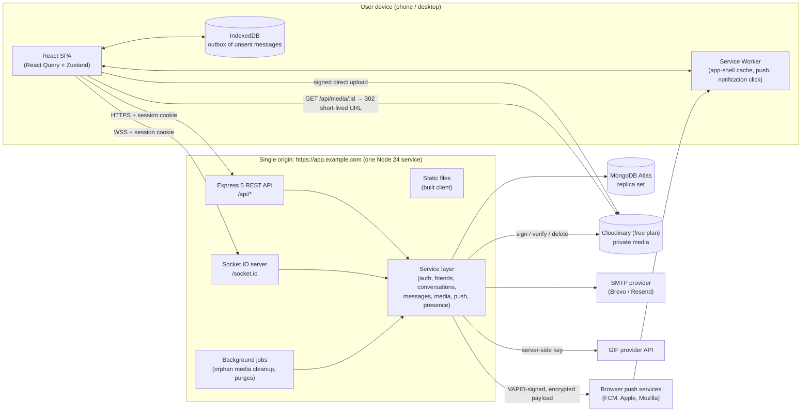
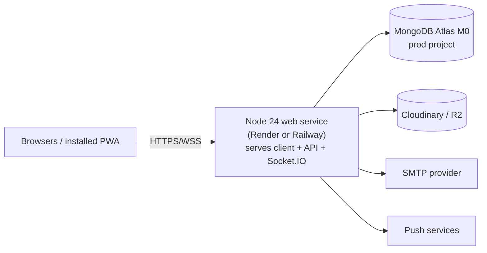

# Architecture (Phase 1)

Status: **Draft for approval** (2026-10-15). It describes the planned system. No code exists yet.

## 1. Technology stack

Versions are the latest stable releases on npm as of 2026-10-15. We'll pin exact versions in `package-lock.json` during Phase 2, after reading each major version's migration notes.

### Runtime

| Tool           | Version                | Why                                                                                       |
| -------------- | ---------------------- | ----------------------------------------------------------------------------------------- |
| Node.js        | **24.x LTS** (24.22.0) | Needed by React Router 8 (≥ 22.22). LTS support runs to 2028. You have 22.17.1 → upgrade. |
| npm workspaces | npm 11                 | One repository, three packages (`client`, `server`, `shared`), one install command.       |

### Frontend (`client/`)

| Package                                               | Version                                               | Why                                                                                                                                                |
| ----------------------------------------------------- | ----------------------------------------------------- | -------------------------------------------------------------------------------------------------------------------------------------------------- |
| react / react-dom                                     | 19.3                                                  | Current stable                                                                                                                                     |
| vite + @vitejs/plugin-react                           | 8.3 / 6.1                                             | Fast dev server and build                                                                                                                          |
| react-router                                          | 8.4                                                   | Routing (requires Node ≥ 22.22)                                                                                                                    |
| tailwindcss + @tailwindcss/vite                       | 4.3                                                   | Design tokens as CSS variables (`@theme`) and no runtime CSS-in-JS                                                                                 |
| @tanstack/react-query                                 | 5.x                                                   | Server state, caching, pagination, refetch after reconnect                                                                                         |
| zustand                                               | 5.x                                                   | Small client-only state (socket status, outbox, UI) — only where React Query doesn't fit                                                           |
| socket.io-client                                      | 4.8                                                   | Matches the server                                                                                                                                 |
| lucide-react                                          | 1.x                                                   | Accessible, tree-shakeable icons                                                                                                                   |
| vite-plugin-pwa (injectManifest)                      | 2.0                                                   | Manifest + custom service worker (needed for push handlers)                                                                                        |
| Emoji picker                                          | **frimousse** 0.4 (preferred) or emoji-picker-react 5 | Frimousse is small, unstyled, and accessible, so it fits our design system. I'll check bundle size and accessibility in Phase 7 before committing. |
| Inter Variable (self-hosted via @fontsource-variable) | —                                                     | Highly readable conversational sans-serif. Self-hosting avoids sending users' IPs to a font CDN.                                                   |

### Backend (`server/`)

| Package            | Version                  | Why                                                                                                                                                   |
| ------------------ | ------------------------ | ----------------------------------------------------------------------------------------------------------------------------------------------------- |
| express            | 5.3                      | Native async error handling in v5                                                                                                                     |
| mongoose           | 9.x (MongoDB driver 7.x) | Schemas, indexes, transactions                                                                                                                        |
| socket.io          | 4.8                      | Rooms, acks, reconnection, cookie handshake                                                                                                           |
| zod                | 4.x (in `shared/`)       | One schema validates REST bodies, socket payloads, **and** client forms                                                                               |
| argon2             | 0.45                     | Argon2id password hashing (OWASP recommended)                                                                                                         |
| helmet             | 8.x                      | Security headers + CSP                                                                                                                                |
| express-rate-limit | 8.x                      | Per-IP / per-user limits (memory store in v1)                                                                                                         |
| web-push           | 3.6.7                    | The standard Node Web Push/VAPID library. It's mature and was last released in 2024. It's still the de-facto choice, and I'll re-check it in Phase 9. |
| pino + pino-http   | 10.x                     | Structured logs with redaction                                                                                                                        |
| cloudinary         | 2.x                      | Free plan with no card; transcodes iPhone HEVC video. Behind a storage interface so it can be swapped.                                                |
| nodemailer         | 10.x                     | SMTP transport works with Brevo/Resend/any provider. Vendor-neutral.                                                                                  |

### Testing / quality

| Package                        | Version                       | Use                                                                                       |
| ------------------------------ | ----------------------------- | ----------------------------------------------------------------------------------------- |
| vitest                         | 5.x                           | Unit + integration (server and client)                                                    |
| @testing-library/react + jsdom | latest                        | Component tests                                                                           |
| supertest                      | 7.x                           | HTTP integration tests                                                                    |
| mongodb-memory-server          | 11.x                          | Real `mongod` replica set in tests (transactions work). Downloads a binary on first run.  |
| @playwright/test               | 1.64                          | E2E with two browser contexts = two users. Includes mobile WebKit and Chromium emulation. |
| eslint                         | 10.x (flat config) + prettier | Lint/format                                                                               |

### Language decision (needs your approval — Q1)

**Recommendation: JavaScript (ES modules) + JSDoc + `// @ts-check` in VS Code + Zod schemas in `shared/`.**

- A frontend/backend contract mismatch is the main bug TypeScript would prevent. Shared Zod schemas prevent the same bug **at runtime as well**, which TypeScript alone doesn't, because socket payloads are untrusted input anyway.
- There's no build step for the server, so stack traces are simpler. It's also easier to learn and debug as a student.
- VS Code still shows types from JSDoc, and `z.infer` types can be imported in JSDoc.
- If you prefer TypeScript, the architecture stays the same. Only file extensions and the build step change.

## 2. High-level architecture



Key properties:

- **One origin.** The browser only ever talks to `app.example.com` for app, API and sockets, so cookies are first-party everywhere, including iOS Safari.
- **Socket handlers and controllers are thin.** They validate input with Zod and call services. Services hold all business rules and authorization and are reused by both REST and sockets.
- **MongoDB is the source of truth.** Socket events only tell clients "something changed". A reconnecting client can always rebuild its state from REST.
- **Media bytes never pass through our server on upload.** The client uploads straight to storage with a short-lived signed request. The server verifies the result afterwards.

## 3. Folder structure

```
private-chat-platform/                 (this folder)
├── package.json                       npm workspaces + root scripts (dev, test, lint, build)
├── .gitignore  .editorconfig  .nvmrc  README.md
├── docs/                              REQUIREMENTS, ARCHITECTURE, DATABASE, API, SECURITY,
│                                      TESTING, ROADMAP, SETUP, STATUS (+ DEPLOYMENT in Phase 11)
├── shared/                            @chat/shared — imported by client and server
│   └── src/
│       ├── schemas/                   zod schemas: auth, user, friends, message, media, settings, socket
│       ├── events.js                  socket event names (single source of truth)
│       ├── errors.js                  error codes
│       └── limits.js                  default limits (text length, file sizes…)
├── server/
│   ├── .env.example
│   ├── src/
│   │   ├── config/                    env parsing (zod), db connection, logger
│   │   ├── models/                    mongoose models (one file per model)
│   │   ├── services/                  business logic + authorization (no req/res here)
│   │   ├── controllers/               HTTP adapters: validate → call service → respond
│   │   ├── routes/                    express routers per feature
│   │   ├── middleware/                auth, csrf, origin check, rate limits, validate, errors
│   │   ├── sockets/                   io setup, auth handshake, per-feature event handlers
│   │   ├── providers/                 adapters: mailer, storage, push, gif (swappable)
│   │   ├── jobs/                      periodic cleanup tasks
│   │   ├── utils/                     small pure helpers
│   │   ├── app.js                     express app (no listen) — imported by tests
│   │   └── server.js                  http server + socket.io + listen
│   └── tests/  unit/  integration/  socket/  helpers/
├── client/
│   ├── .env.example
│   ├── index.html
│   ├── public/                        icons, manifest assets, offline.html
│   └── src/
│       ├── app/                       router, providers, query client
│       ├── assets/
│       ├── components/ui/             Button, Input, Avatar, Sheet, Dialog, Menu, Toast…
│       ├── features/                  auth/ chat/ friends/ media/ notifications/ profile/ settings/
│       │                              (each: api.js, hooks, components, pages)
│       ├── hooks/                     generic hooks (useMediaQuery, useLongPress, useVisualViewport)
│       ├── layouts/                   AuthLayout, AppShell (mobile + desktop)
│       ├── lib/                       http client, socket client, outbox, formatters
│       ├── services/platform/         notifications, file picker, storage, share — web now, Capacitor later
│       ├── styles/                    tokens.css, base.css
│       ├── sw.js                      service worker source
│       └── main.jsx
└── e2e/                               Playwright tests + config
```

I changed the master-prompt template in three ways, each for a technical reason:

- I added `shared/` to hold the contract.
- I added `server/src/providers/` so external services can be swapped or mocked.
- I added `client/src/services/platform/` to isolate platform features for a future Capacitor wrapper.

`pages/` lives inside each feature folder, which keeps each feature self-contained.

## 4. Request flow and layering rules

```
HTTP:   route → middleware(auth, csrf, rateLimit, validate(zod)) → controller → service → model
Socket: io.use(auth) → handler(validate(zod), rateLimit) → service → model → emitter
```

- Services receive an explicit `actor` (`{ userId, sessionId }`) and must authorize every object they touch.
- Only `services/realtime.js` emits socket events, so business code never knows about socket rooms.
- No circular imports: `models ← services ← (controllers | sockets | jobs)`. ESLint `import/no-cycle` enforces this.

## 5. Real-time design

### Rooms (server-controlled)

- On connect, each socket is joined to exactly two rooms: `user:<userId>` and `session:<sessionId>`. **Clients can never join a room.** No event exists for that.
- A new message is emitted to `user:<senderId>` and `user:<recipientId>`. Because conversations are one-to-one, there are no conversation rooms to abuse.
- Revoking a session emits `session:revoked` to `session:<id>` and disconnects those sockets.

### Handshake authentication

1. The client connects to the same origin with `withCredentials`, so the cookie is sent automatically.
2. Middleware checks the `Origin` header against the allowlist (blocks cross-site WebSocket hijacking). It then reads the session cookie, hashes it, and loads an active session.
3. Unauthenticated → `connect_error` with `UNAUTHENTICATED`. The client stops reconnecting and goes to login.
4. Every 5 minutes, and before sensitive events, the session is re-checked. Expired or revoked → disconnect.

### Event processing

Every client→server event:

1. Runs through a Zod schema (unknown keys rejected).
2. Is rate-limited per user.
3. Calls a service, which authorizes it.
4. Replies through the Socket.IO **acknowledgement callback** with `{ ok: true, data } | { ok: false, error: { code, message } }`.

Full contract: API.md §3.

## 6. Message sequencing, receipts and unread counts

- Each conversation stores a counter `lastSeq`. A new message takes `seq = ++lastSeq` atomically inside the same transaction that inserts it. `(conversationId, seq)` is unique. **`seq` is the pagination cursor and the ordering key.** It never changes, unlike timestamps that can collide.
- Each member record stores **watermarks**: `deliveredUpToSeq` and `readUpToSeq`. A message from A to B is:
  - **Sending** — exists only on A's device (outbox), no server ack yet.
  - **Sent** — the server committed it (the ack returned `seq`).
  - **Delivered** — `seq ≤ B.deliveredUpToSeq`. B's app on any device acknowledged it.
  - **Seen** — `seq ≤ B.readUpToSeq` (shown only if both users allow read receipts).
- Watermarks only move forward (`$max`), so stale or out-of-order receipt events are harmless.
- **Delivered policy:** the recipient's client sends `message:delivered { conversationId, upToSeq }` after it has put the message into its local cache. This happens for live socket messages and also after fetching history or the conversation list. A push notification **does not** count, and neither does the emit alone.
- **Seen policy:** the client sends `conversation:read { upToSeq }` only when all of these are true:
  - the chat screen for that conversation is mounted,
  - `document.visibilityState === 'visible'`,
  - the window has focus,
  - the message element is ≥ 50% visible (IntersectionObserver).

  These reports are debounced to about one per 500 ms.

- **The unread preview** uses `GET /api/conversations/:id/preview`. It has no read side effects, and the client never emits `conversation:read` from preview UI. A test enforces this.
- **Unread count** = the number of messages in the conversation with `seq > readUpToSeq`, `senderId ≠ me`, not unsent, and not hidden for me. It's an indexed `countDocuments` with `limit: 100` (shows "99+"), so it's bounded and can't drift the way a separately maintained counter can.

## 7. Reliability: sending, retries, reconnects

```mermaid
sequenceDiagram
  participant A as Sender device
  participant S as Server
  participant DB as MongoDB
  participant B as Recipient device(s)
  A->>A: create clientMessageId (UUID v4), save to IndexedDB outbox, render "sending"
  A->>S: message:send {conversationId, clientMessageId, text}
  S->>S: validate, rate-limit, assertCanMessage(A, conversation)
  S->>DB: txn: $inc lastSeq → insert message (unique senderId+clientMessageId) → update members
  alt duplicate clientMessageId
    DB-->>S: duplicate key → load existing message
  end
  S-->>A: ack {ok, message(seq, createdAt)}  → "sent", remove from outbox
  S-->>A: message:new (A's other devices)
  S-->>B: message:new
  B->>S: message:delivered {upToSeq}
  S->>DB: $max deliveredUpToSeq
  S-->>A: receipt:update {deliveredUpToSeq}
  S-)S: if B has no visible client → web push (async; failure never affects the message)
```

- **Retry:** if no ack arrives within 10 s, or the socket is down, the item stays in the outbox. Sending is retried on reconnect with the **same** `clientMessageId`, so it's idempotent. After 3 failed attempts or a permanent error (e.g. `NOT_FRIENDS`), the message shows "Failed — tap to retry".
- **Outbox persistence:** IndexedDB, scoped per user and cleared on logout. Unsent text survives a reload or a closed tab. It is stored only on that device.
- **Reconnect sync:**
  1. Refetch the conversation list (`lastSeq` + watermarks).
  2. For the open conversation, `GET messages?after=<highest seq I have>`.
  3. `GET messages/changes?since=<last sync time>` to catch edits, unsends, reactions and pins in the loaded range.
  4. Flush the outbox.
  5. Re-send the delivered/read watermarks.
- **Duplicate events:** the client merges by `_id` (and by `clientMessageId` for its own sends), and newer `version` wins. Repeated or stale events are ignored.
- **Listener hygiene:** one socket instance per tab. It's created after login, destroyed on logout, and listeners are registered once in a single module, not in components.

## 8. Presence and typing

- The server keeps `Map<userId, Map<socketId, { visible, lastActiveAt }>>` in memory (single instance in v1).
- **Online** = at least one connected socket that reported `visible: true` in the last 60 s. Socket.IO's built-in heartbeat (`pingInterval` 25 s, `pingTimeout` 20 s) removes dead connections.
- **Going offline:** when the last socket disconnects, the server waits 8 s before broadcasting offline, so quick reconnects don't flicker. It then writes `lastSeenAt`.
- Presence goes only to accepted friends who are allowed to see it (privacy settings + reciprocity + no block).
- **Typing:**
  - The client sends `typing:start` at most once every 3 s while the user types, and sends `typing:stop` on send, blur, or 5 s of idle.
  - Receivers expire the indicator after 6 s without a refresh.
  - The server sends `typing:stop` for any conversation where the user was typing when their socket disconnects.
- **Scaling path (not v1):** add `@socket.io/redis-adapter`, store presence in Redis with TTL leases, and use a Redis store for rate limits. This is documented, not built.

## 9. Media pipeline

1. Client: `POST /api/media/uploads { purpose, conversationId, kind, mimeType, size }`.
2. The server checks membership, limits, and allowed types. It creates an `Attachment` (`status: pending`) and returns signed upload parameters that expire in 10 minutes and are locked to one key/folder, type, and maximum size.
3. The client uploads directly to storage with an XHR (progress events and cancel via `abort()`).
4. Client: `POST /api/media/uploads/:id/complete`. The server fetches the object's metadata from the provider and checks size, real format (magic bytes or provider-detected format), and dimensions/duration. It then marks the attachment `ready`, or deletes it and returns `INVALID_MEDIA`.
5. The message references only attachments that are `ready`, owned by the sender, and created for this conversation.
6. **Viewing:** `GET /api/media/:id?variant=thumb|full` checks that the requester is still a participant and the message isn't unsent, then redirects (302) to a provider URL. The page never stores permanent public URLs.
7. **Cleanup job:** pending uploads older than 24 h, and media of unsent messages, are deleted from storage and the DB.

Layout stability: width, height, and duration are stored, so the UI reserves the exact aspect-ratio box before the media loads.

## 10. Deployment architecture (decided 2026-10-17: Vercel + Render)

The app is named **Adda**. **Vercel** serves the built app and **Render** (free) runs Express + Socket.IO, because Vercel can't keep a server running or accept WebSockets.

- **Login cookies stay first-party:** Vercel forwards `/api/*` to Render, so the session cookie (`__Host-sid`) belongs to the Vercel address. No third-party cookies anywhere.
- **The live connection goes straight to Render** (`VITE_SOCKET_URL`), because Vercel can't forward WebSockets.
  - It can't carry the cookie, so the app first gets a **one-time ticket**: `POST /api/realtime/ticket`, cookie + CSRF, random, single use, 60 s, bound to the login session.
  - Socket.IO accepts only the app's origin (CORS + Origin check). Revoking the session still disconnects the socket.
- **Security headers:** Vercel applies them from `vercel.json`, generated by `scripts/vercel-config.mjs` from the same policy Express uses (`server/src/config/contentSecurity.js`).

The original single-host diagram below still applies to `npm run app:local` and to a Render-only setup.



- Single instance in v1. HTTPS comes from the host. `trust proxy` is set to exactly one hop, so client IPs used for rate limiting are correct.
- The production database is in a separate Atlas project from development. Each environment has its own DB user with `readWrite` on only its own database.
- Free tiers sleep when idle (Render free sleeps after about 15 min). After a sleep, the first request takes ~30–60 s, and the client shows "Reconnecting…". Because the project is zero-cost, this delay is an accepted limitation; there is no paid upgrade.

## 11. PWA and iPhone compatibility

| Area                 | Plan                                                                                                                                                                                                                                                                                    |
| -------------------- | --------------------------------------------------------------------------------------------------------------------------------------------------------------------------------------------------------------------------------------------------------------------------------------- |
| Manifest             | name, short_name, `display: standalone`, `start_url: /`, `scope: /`, theme `#592E83`, background colors for light/dark, maskable 192/512 icons + 180 px `apple-touch-icon`                                                                                                              |
| Service worker       | Precaches **only** the hashed app shell (JS/CSS/fonts/icons). `/api/*`, `/socket.io/*`, and media are **network-only** and never stored in Cache Storage. Has an offline fallback page.                                                                                                 |
| Updates              | Prompts "New version available — Reload" (no silent `skipWaiting`, which can break a chat in progress).                                                                                                                                                                                 |
| Push                 | `push` handler always calls `showNotification` (an iOS requirement). The notification uses `tag = conversationId`, so new messages replace older ones instead of stacking. `notificationclick` focuses an existing window or opens `/chat/:id`. `pushsubscriptionchange` re-subscribes. |
| Permission UX        | An "Enable notifications" button is shown only when supported. On iOS outside standalone mode, an "Add to Home Screen" guide is shown instead. If permission is denied, settings explain how to re-enable it.                                                                           |
| iOS layout           | `viewport-fit=cover`, `env(safe-area-inset-*)`, `100dvh`, `visualViewport` resize handling for the composer, no `position: fixed` jumps, `overscroll-behavior: contain` on scroll areas                                                                                                 |
| Badges               | `navigator.setAppBadge(unreadTotal)` where supported (installed iOS 16.4+, Chromium desktop)                                                                                                                                                                                            |
| Limits to tell users | No background sockets, no calls, no notification action buttons on iOS. Push requires Home Screen install on iOS. If the user removes the app or clears site data, the subscription is gone.                                                                                            |

PWA vs native: an installed PWA runs only while open, except for its service worker reacting to push. A native app can do more background work, has richer notifications, and gets OS share-sheet targets. That's what the later Capacitor route would add.

## 12. Future native wrapper (Capacitor) — prepared, not built

- Device features go through `client/src/services/platform/*`, which has a web implementation today and a Capacitor implementation later.
- Server push goes through a `NotificationChannel` interface. Today it's `webpush`. Later it can be `fcm`/`apns` without touching message code.
- Known issue to solve before wrapping: Capacitor apps run on `capacitor://localhost` / `https://localhost`, so cookie auth becomes cross-site. Options: CapacitorHttp with native cookie storage, or a separate token-based native session. This decision is deferred to the wrapper phase.
