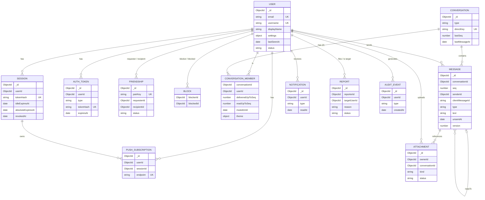

# Database Design (Phase 1)

Status: **Draft for approval** (2026-10-15). MongoDB (Atlas replica set) via Mongoose 9. Not implemented yet.

## 1. Conventions

- `_id` is an ObjectId everywhere. All references are ObjectIds. `createdAt`/`updatedAt` come from Mongoose `timestamps`, using **server time only**.
- `mongoose.set('strictQuery', true)`. Every input is parsed by a strict Zod schema (primitives only, unknown keys rejected) before it reaches a query; raw request objects are never used as filters. Mongoose's global `sanitizeFilter` is not used because it also strips the server's own operators.
- No unbounded arrays. The only embedded arrays are capped (participants = 2, reactions ≤ 2, attachments ≤ 10, hiddenFor ≤ 2).
- Pair keys: for any two users, `pairKey = "<smallerId>:<largerId>"`. A unique index on it prevents duplicate friendships or conversations, even under concurrent requests.
- Transactions are used when one action writes several documents that must agree. Examples: sending a message, accepting a request, blocking, deleting an account.

## 2. Collections (11)

I evaluated the master-prompt list and dropped two separate collections:

- **UserSettings** is embedded in `User`. It's small, 1:1, and always read with the user.
- **ConversationSettings** is merged into `ConversationMember`. It's per user per conversation, and that document already exists for receipts.

I added four collections the features need: `AuthToken`, `Attachment`, `Notification`, and `AuditEvent`.

### 2.1 User

Purpose: identity, public profile, settings.

| Field                                 | Type                                  | Rules                                                                                                                         |
| ------------------------------------- | ------------------------------------- | ----------------------------------------------------------------------------------------------------------------------------- |
| email                                 | String                                | required, lowercased, trimmed, valid email, ≤ 254, **unique**                                                                 |
| emailVerifiedAt                       | Date \| null                          |                                                                                                                               |
| passwordHash                          | String                                | required, Argon2id encoded string, `select: false`                                                                            |
| username                              | String                                | required, 3–20 chars `^[a-z0-9](?:[a-z0-9._]{1,18})[a-z0-9]$`, no `..`, stored lowercased, **unique**, reserved names blocked |
| usernameChangedAt                     | Date                                  | for the 7-day change limit                                                                                                    |
| displayName                           | String                                | required, 1–40 chars after trim, control characters stripped                                                                  |
| bio                                   | String                                | ≤ 160                                                                                                                         |
| avatar                                | { attachmentId, version } \| null     |                                                                                                                               |
| settings.theme                        | enum `system\|light\|dark`            | default `system`                                                                                                              |
| settings.privacy.lastSeen             | enum `friends\|nobody`                | default `friends`                                                                                                             |
| settings.privacy.onlineStatus         | enum `friends\|nobody`                | default `friends`                                                                                                             |
| settings.privacy.readReceipts         | Boolean                               | default true                                                                                                                  |
| settings.privacy.discoverable         | Boolean                               | default true                                                                                                                  |
| settings.notifications.enabled        | Boolean                               | default true                                                                                                                  |
| settings.notifications.preview        | enum `name_and_text\|name_only\|none` | default `name_only`                                                                                                           |
| settings.notifications.friendRequests | Boolean                               | default true                                                                                                                  |
| lastSeenAt                            | Date                                  |                                                                                                                               |
| status                                | enum `active\|deleted`                | default `active`                                                                                                              |
| deletedAt                             | Date                                  |                                                                                                                               |

Indexes: `{email:1}` unique · `{username:1}` unique (prefix search uses `^escaped` regex on this index).
Retention: on deletion the document becomes a tombstone (`status: deleted`, email/username/displayName/bio/avatar/passwordHash removed, username freed), so existing message references still resolve to "Deleted account".
Authorization: only the owner reads private fields. Others get a **public projection** (`_id, username, displayName, avatar, bio`), plus presence fields only when privacy rules allow.

### 2.2 Session

Purpose: server-side login sessions (the cookie holds a random 256-bit token; only its SHA-256 hash is stored).

| Field             | Type            | Rules                                                                             |
| ----------------- | --------------- | --------------------------------------------------------------------------------- |
| userId            | ObjectId → User | required                                                                          |
| tokenHash         | String          | required, **unique**                                                              |
| csrfToken         | String          | random; must be sent back in `X-CSRF-Token` on state-changing requests            |
| createdAt         | Date            |                                                                                   |
| lastUsedAt        | Date            | updated at most once per 5 min (limits write load)                                |
| idleExpiresAt     | Date            | lastUsedAt + 30 days                                                              |
| absoluteExpiresAt | Date            | createdAt + 180 days                                                              |
| userAgent         | String          | ≤ 200, shown as "Chrome on Android"                                               |
| ipPrefix          | String          | truncated (/24 IPv4, /48 IPv6) — enough to recognize a device, not to track users |
| revokedAt         | Date \| null    |                                                                                   |

Indexes: `{tokenHash:1}` unique · `{userId:1, revokedAt:1}` · TTL `{absoluteExpiresAt:1}, expireAfterSeconds: 0`.
Authorization: a user may list or revoke only their own sessions.

### 2.3 AuthToken

Purpose: one-time email links (verify email, reset password, confirm email change).

| Field     | Type                                              | Rules                                         |
| --------- | ------------------------------------------------- | --------------------------------------------- |
| userId    | ObjectId                                          | required                                      |
| type      | enum `verify_email\|reset_password\|change_email` |                                               |
| tokenHash | String                                            | SHA-256 of a 256-bit random token, **unique** |
| newEmail  | String                                            | only for `change_email`                       |
| expiresAt | Date                                              | verify 24 h, reset 30 min, change 24 h        |
| usedAt    | Date \| null                                      |                                               |

Indexes: `{tokenHash:1}` unique · `{userId:1, type:1}` · TTL on `expiresAt`.
Issuing a new token of the same type deletes the older ones. Consuming a token is a single atomic `findOneAndUpdate({usedAt:null, expiresAt>{now}})`.

### 2.4 Friendship

Purpose: friend requests and accepted friendships (one document per pair).

| Field                 | Type                               | Rules                |
| --------------------- | ---------------------------------- | -------------------- |
| pairKey               | String                             | **unique**           |
| userIds               | [ObjectId, ObjectId]               | sorted               |
| requesterId           | ObjectId                           | who sent the request |
| recipientId           | ObjectId                           |                      |
| status                | enum `pending\|accepted\|declined` |                      |
| respondedAt           | Date                               |                      |
| createdAt / updatedAt | Date                               |                      |

Indexes: `{pairKey:1}` unique · `{recipientId:1, status:1, createdAt:-1}` (incoming) · `{requesterId:1, status:1, createdAt:-1}` (outgoing) · `{userIds:1, status:1}` (friend list).

State transitions (all other transitions are rejected):

```
(none) --send--> pending --accept (recipient)--> accepted --remove (either)--> (deleted)
                 pending --cancel (requester)--> (deleted)
                 pending --decline (recipient)--> declined --7 days later, requester may send again--> pending
any state --block (either)--> (deleted)
```

- If B sends a request while A→B is already pending, the API returns `409 REQUEST_EXISTS_INCOMING` with the existing request, so the client can show "Accept". This prevents crossed requests.
- To the requester, `declined` looks the same as "no relationship". The only difference is the 7-day cooldown.

### 2.5 Block

| Field     | Type     | Rules       |
| --------- | -------- | ----------- |
| blockerId | ObjectId |             |
| blockedId | ObjectId | ≠ blockerId |
| createdAt | Date     |             |

Indexes: `{blockerId:1, blockedId:1}` unique · `{blockedId:1}`.
Block effects (one transaction):

- delete the Friendship document
- hide each user from the other in search
- stop presence and typing between them
- reject messages in both directions

Existing history stays visible but read-only. The blocked user is **not told** they were blocked. They just can't send, which looks the same as "not friends".

### 2.6 Conversation

| Field          | Type             | Rules                                |
| -------------- | ---------------- | ------------------------------------ |
| type           | enum `direct`    | `group` reserved for the future      |
| participantIds | [ObjectId]       | exactly 2 for `direct`, sorted       |
| directKey      | String           | pairKey, **unique sparse**           |
| lastSeq        | Number           | starts at 0, incremented per message |
| lastMessageId  | ObjectId \| null |                                      |
| lastMessageAt  | Date \| null     |                                      |

Indexes: `{directKey:1}` unique (partial: type=direct) · `{participantIds:1}`.

### 2.7 ConversationMember

Purpose: per-user conversation state + settings (receipts, mute, theme).

| Field            | Type                                                              | Rules                                                         |
| ---------------- | ----------------------------------------------------------------- | ------------------------------------------------------------- |
| conversationId   | ObjectId                                                          |                                                               |
| userId           | ObjectId                                                          |                                                               |
| peerId           | ObjectId                                                          | denormalized (direct chats) for the list query                |
| lastMessageAt    | Date                                                              | copied from the conversation for sorting the list             |
| deliveredUpToSeq | Number                                                            | monotonic (`$max`)                                            |
| readUpToSeq      | Number                                                            | monotonic (`$max`)                                            |
| clearedUpToSeq   | Number                                                            | "clear chat for me": messages ≤ this are hidden for this user |
| mutedUntil       | Date \| null                                                      | far-future date = muted forever                               |
| theme            | { accent: enum of preset tokens, wallpaper: enum preset } \| null | presets only — no arbitrary CSS                               |
| pinnedAt         | Date \| null                                                      | pin the conversation in the list                              |
| archivedAt       | Date \| null                                                      |                                                               |

Indexes: `{conversationId:1, userId:1}` unique · `{userId:1, archivedAt:1, pinnedAt:-1, lastMessageAt:-1}` (conversation list).
Authorization: **a ConversationMember document is the single proof of access to a conversation.** Every conversation and message query starts with `assertMember(actor, conversationId)`.

### 2.8 Message

| Field                 | Type                                                                | Rules                                           |
| --------------------- | ------------------------------------------------------------------- | ----------------------------------------------- |
| conversationId        | ObjectId                                                            |                                                 |
| seq                   | Number                                                              | per-conversation sequence                       |
| senderId              | ObjectId                                                            |                                                 |
| clientMessageId       | String                                                              | UUID v4 from the client (idempotency)           |
| type                  | enum `text\|media\|gif`                                             | media = photos/videos; text is then a caption   |
| text                  | String \| null                                                      | ≤ 4000, NFC-normalized; null when unsent        |
| attachments           | [{ attachmentId, kind, mimeType, width, height, durationMs, size }] | ≤ 10; snapshot of ready attachments             |
| gif                   | { provider, id, width, height, previewUrl, url, title } \| null     | URL host must be in the provider allowlist      |
| replyToId             | ObjectId \| null                                                    | must be in the same conversation                |
| reactions             | [{ userId, emoji, at }]                                             | ≤ 1 per user; emoji = a single RGI emoji        |
| editedAt              | Date \| null                                                        |                                                 |
| unsentAt              | Date \| null                                                        | tombstone                                       |
| hiddenFor             | [ObjectId]                                                          | "delete for me"                                 |
| pinnedAt / pinnedBy   | Date / ObjectId                                                     |                                                 |
| version               | Number                                                              | +1 on every change (client conflict resolution) |
| createdAt / updatedAt | Date                                                                |                                                 |

Indexes:

- `{conversationId:1, seq:-1}` **unique** — pagination, ordering, unread counts
- `{senderId:1, clientMessageId:1}` **unique** — idempotent sends
- `{conversationId:1, updatedAt:1}` — reconnect change sync
- `{conversationId:1, pinnedAt:-1}` partial `{pinnedAt: {$type: 'date'}}` — pinned list
- `{text: 'text'}` (language `none`, so mixed English/Bangla text isn't stemmed incorrectly) — search, combined with a `conversationId: {$in: myConversationIds}` filter; limitations in API.md §2.8

Retention: messages are kept until a user clears or unsends them, or both members' accounts are deleted. Unsend sets `text: null, attachments: [], gif: null, reactions: []` and deletes the media from storage.

### 2.9 Attachment

| Field                     | Type                                      | Rules                                                                    |
| ------------------------- | ----------------------------------------- | ------------------------------------------------------------------------ |
| ownerId                   | ObjectId                                  | uploader                                                                 |
| purpose                   | enum `message\|avatar`                    |                                                                          |
| conversationId            | ObjectId \| null                          | required for `message`                                                   |
| messageId                 | ObjectId \| null                          | set when attached                                                        |
| kind                      | enum `image\|video`                       |                                                                          |
| mimeType                  | String                                    | allowlist: image/jpeg, png, webp, gif, heic*, video/mp4, quicktime, webm |
| size                      | Number                                    | ≤ configured limit                                                       |
| width, height, durationMs | Number                                    | filled in at verification                                                |
| storage                   | { provider, key, resourceType }           | never sent to clients                                                    |
| status                    | enum `pending\|ready\|attached\|deleting` | `deleting` = the cleanup job removes the file, then this document        |
| expiresAt                 | Date \| null                              | pending uploads: now + 24 h                                              |

Indexes: `{ownerId:1, status:1}` · `{status:1, expiresAt:1}` (cleanup job) · `{messageId:1}`.
Authorization for viewing: purpose=`avatar` → any logged-in user who can see the profile. Purpose=`message` → current members of the conversation, unless the message is unsent or hidden for the requester.

(*HEIC/HEIF is accepted: Cloudinary converts it for other devices (`f_auto`), and iPhone HEVC videos are converted once to H.264 MP4 right after upload.)

### 2.10 PushSubscription

| Field         | Type             | Rules                                                                 |
| ------------- | ---------------- | --------------------------------------------------------------------- |
| userId        | ObjectId         |                                                                       |
| sessionId     | ObjectId         | the subscription is deleted when its session is revoked or logged out |
| endpoint      | String           | https URL, host must be a known push service, **unique**              |
| keys          | { p256dh, auth } | base64url, validated lengths                                          |
| userAgent     | String           |                                                                       |
| lastSuccessAt | Date             |                                                                       |
| failureCount  | Number           | deleted after a 404/410 response, or after 5 consecutive failures     |

Indexes: `{endpoint:1}` unique · `{userId:1}` · `{sessionId:1}`.

### 2.11 Notification (in-app feed) · Report · AuditEvent

**Notification**: `{ userId, type: friend_request|friend_accepted|security, actorId?, data, readAt, createdAt }` — index `{userId:1, createdAt:-1}`, TTL 90 days. Message notifications aren't stored here, because the unread counts already cover them.

**Report**: `{ reporterId, targetUserId, messageId?, conversationId?, reason: enum spam|harassment|impersonation|inappropriate|other, details ≤ 1000, status: open|reviewed|closed, createdAt }` — index `{targetUserId:1, createdAt:-1}`, `{status:1}`, unique `{reporterId, targetUserId, messageId}` (no duplicate reports). Reporting a message lets the server keep a copy of that one message for review, even if it's later unsent. Users are told this in the report dialog.

**AuditEvent**: `{ userId, type: login|login_failed|logout|password_changed|password_reset|email_changed|session_revoked|account_deleted|username_changed, sessionId?, ipPrefix, userAgent, createdAt }` — index `{userId:1, createdAt:-1}`, TTL 180 days. It never contains passwords, tokens, or message content.

## 3. ER diagram



## 4. Critical write operations (transactions)

| Operation             | Documents written atomically                                                                                                                                                                                     |
| --------------------- | ---------------------------------------------------------------------------------------------------------------------------------------------------------------------------------------------------------------- |
| Send message          | Conversation (`$inc lastSeq`, last message) · Message insert · 2× ConversationMember (`lastMessageAt`) · Attachments → `attached`                                                                                |
| Accept friend request | Friendship → accepted · Notification for requester                                                                                                                                                               |
| Block                 | Block insert · Friendship delete                                                                                                                                                                                 |
| Start conversation    | Conversation upsert by `directKey` · 2× ConversationMember upsert (repeatable — a concurrent second call finds the existing one)                                                                                 |
| Delete account        | User tombstone · Sessions revoked · Friendships/Blocks/PushSubscriptions/AuthTokens/Notifications deleted · ConversationMember removed. Storage deletes run **after** commit and are retried by the cleanup job. |

## 5. Retention summary

| Data                   | Kept until                                                                         |
| ---------------------- | ---------------------------------------------------------------------------------- |
| Sessions               | revoked/expired (TTL at absolute expiry; revoked rows deleted by job after 7 days) |
| Auth tokens            | used or expired (TTL)                                                              |
| Messages               | unsent / cleared by the user / both accounts deleted                               |
| Pending uploads        | 24 h                                                                               |
| Notifications          | 90 days                                                                            |
| Audit events           | 180 days                                                                           |
| Reports                | until reviewed + 1 year (manual policy; no admin UI in v1)                         |
| Deleted user tombstone | kept while any message references it                                               |
