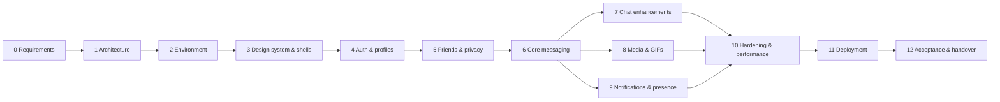

# Work Breakdown Structure and Roadmap

Status: **Draft for approval** (2026-10-15). Phases 0–1 are documents only. Each later phase ends with the phase gate in TESTING.md §7, a STATUS.md update, and a stop for your review.

Note: typing indicators were built in Phase 6; online/last-seen presence stays entirely in Phase 9 (decided during Phase 6 to keep the phase reviewable).

---

## Phase 0 — Requirements and feasibility ✅ approved

- **Deliverables:** REQUIREMENTS.md (inventory, decisions, open questions, constraints, acceptance criteria, risks)
- **Acceptance:** ✅ approved 2026-10-16 with the zero-cost constraint (REQUIREMENTS.md §4).

## Phase 1 — Architecture and planning ✅ approved

- **Deliverables:** ARCHITECTURE.md, DATABASE.md, API.md, SECURITY.md, TESTING.md, ROADMAP.md, SETUP.md
- **Acceptance:** you approve the architecture; the contracts are stable enough to start building.

## Phase 2 — Development environment ✅ complete (2026-10-16)

- **Prerequisites:** Phase 1 approved. Node 24 LTS installed. MongoDB Atlas dev cluster + connection string in `server/.env` (SETUP.md steps 1–3).
- **Tasks:**
  - 2.1 `git init` + `.gitignore` (before any secret exists) + `.editorconfig`, `.nvmrc`
  - 2.2 npm workspaces: `client`, `server`, `shared`. Pin exact versions after reading migration notes (Vite 8, React Router 8, Mongoose 9, Zod 4, Vitest 5, ESLint 10).
  - 2.3 ESLint flat config + Prettier
  - 2.4 Server skeleton: env validation (Zod), logger with redaction, Mongo connection, helmet, error handler, `/api/health` + `/api/health/ready`, graceful shutdown
  - 2.5 Client skeleton: Vite + React + Tailwind + router + React Query. Vite dev proxy for `/api` and `/socket.io` (same-origin in dev).
  - 2.6 Test harness: Vitest projects, mongodb-memory-server replica set, a first real test per package; Playwright installed with a smoke test
  - 2.7 Root scripts: `dev` (both apps), `lint`, `test`, `build`, `check`, `start` (server serves the built client)
- **Acceptance:** `npm run dev` starts both apps; `/api/health/ready` reports DB ok; `npm run check` passes; the production server serves the built client.
- **Tests:** health endpoint integration test, env-validation unit test, Playwright smoke test (page loads, no console errors).

## Phase 3 — Design system and UI foundation ✅ complete (2026-10-16)

- **Prerequisites:** Phase 2.
- **Tasks:**
  - 3.1 Tokens (`styles/tokens.css`): color scales from Teakhelet `#592E83`, dark palette, spacing, radii, shadows, typography, motion durations; contrast checked (WCAG AA minimum)
  - 3.2 Theme provider: system/light/dark, no flash on load (inline-free approach compatible with the CSP)
  - 3.3 UI primitives: Button, IconButton, Input, PasswordInput, Avatar, Badge, Spinner/Skeleton, Dialog, Sheet (mobile bottom sheet), Menu, Toast, EmptyState, ErrorState
  - 3.4 Layouts: AuthLayout; AppShell (mobile: list ↔ chat + bottom nav; desktop ≥ 1024 px: list | chat | details panel)
  - 3.5 Viewport handling: `100dvh`, safe areas, `visualViewport` composer behavior
  - 3.6 Auth screen UIs (not yet wired), conversation list and chat shells using **static sample data clearly marked as design fixtures**
- **Acceptance:** layouts verified at 360/390/768/1440 px, both themes, keyboard focus visible, reduced motion respected.
- **Tests:** component tests for primitives (a11y roles, keyboard), Playwright screenshots at 4 viewports for review.
- **Scope changes made during the phase (to avoid unused or fake code):**
  - Input/PasswordInput, AuthLayout and the auth screens move to **Phase 4**, where they're wired to the real API. They aren't built as unconnected mock-ups.
  - Dialog, Sheet, Menu and Toast are built in the phase that first uses them (Phase 4/7), so no unused components ship.
  - An automated WCAG contrast test (`client/src/styles/tokens.test.js`) was added. It found and fixed a failing grey used for timestamps and placeholders.

## Phase 4 — Authentication and profiles ✅ complete (2026-10-16)

- **Prerequisites:** Phase 3. Email provider decided (dev uses the console transport).
- **Tasks:** Input/PasswordInput primitives + AuthLayout and auth screens (moved from Phase 3) → User/Session/AuthToken/AuditEvent models → auth service → CSRF + origin middleware → register/login/logout/session → email verification → forgot/reset → reauth/change password/change email → sessions list/revoke → profile edit, username change → avatar (**built in Phase 8**, see note) → settings endpoint → account deletion (core). Client: forms with shared Zod schemas, protected routes, session bootstrap, settings screens.
- **Acceptance:** E2E journeys 1, 2, 11 (profile parts), 12 pass. Session policy behaves as documented.
- **Tests:** auth integration suite, rate-limit tests, enumeration-safety tests, cookie flag tests.
- **Note:** avatar upload needs the media pipeline, so it moves to Phase 8. Initials avatars are used until then.
- **Change during the phase:** the separate `/reauth` step was replaced by requiring the current password inside each sensitive request (simpler and equally safe).

## Phase 5 — Friendships and privacy ✅ complete (2026-10-16)

- **Prerequisites:** Phase 4.
- **Tasks:** Friendship/Block/Report/Notification models; search; request state machine; block/unblock; report; in-app notification feed; socket server foundation (auth handshake, user/session rooms, `friendship:updated`, `notification:new`); friends UI (search, requests, list, profile card).
- **Acceptance:** E2E journeys 3–4; every invalid transition rejected; blocked users invisible.
- **Tests:** state-machine unit tests, crossed-request concurrency test, authorization matrix (first version), socket handshake tests (no cookie, bad origin, revoked session).

## Phase 6 — Core messaging ✅ complete (2026-10-16)

- **Prerequisites:** Phase 5.
- **Tasks:** Conversation/ConversationMember/Message models; start conversation; send (transaction, seq, idempotency) via socket + REST fallback; history pagination; delivered/read watermarks; unread counts; presence registry + typing; client: socket client module, outbox (IndexedDB), message list (scroll anchoring, unread divider, load older without jumping), composer, ticks, reconnect sync.
- **Acceptance:** E2E journeys 5–6; no duplicates or losses in the reconnect tests; two devices stay in sync.
- **Tests:** full real-time suite (TESTING.md §3), authorization matrix extended to messages, a load sanity check (e.g. 2,000 messages paginated smoothly).

## Phase 7 — Chat enhancements ✅ complete (2026-10-17)

- **Change:** multi-select of several messages moved to Phase 10; the desktop details panel was replaced by a "Chat options" sheet that also works on phones.

- **Prerequisites:** Phase 6.
- **Tasks:** edit, delete for me, unsend, reactions + emoji picker, reply, pin + pinned bar, copy, multi-select, context menu (long-press / right-click / keyboard), clear chat, mute, per-conversation theme, **long-press unread preview**, message search (in-chat + global with jump-to-context).
- **Acceptance:** E2E journeys 8–9; preview proven to have no read side effects.
- **Tests:** rules for every action (windows, ownership), change-sync after reconnect, search scoping.

## Phase 8 — Media and GIFs ✅ complete (2026-10-17)

- **Prerequisites:** Phase 6. Storage account (SETUP.md step 5). GIF key optional.
- **Tasks:** storage provider adapter; upload init/complete/cancel; verification; authorized delivery; cleanup job; attachment picker, previews, progress, cancel/retry, placeholders without layout shift, lightbox, video player; avatar upload; GIF picker + fallback (browser-direct to KLIPY instead of a proxy, as KLIPY's terms require).
- **Acceptance:** E2E journey 7; a disguised file is rejected; a non-member can't fetch media.
- **Tests:** upload validation suite with fixtures, authorization tests, cleanup job test.

## Phase 9 — Notifications and presence ✅ complete (2026-10-17; real-device push test in Phase 11)

- **Prerequisites:** Phase 6 (Phase 7/8 for complete payloads). VAPID keys generated (SETUP.md step 6).
- **Tasks:** PWA manifest + service worker (injectManifest), install guide, update prompt, offline page; push subscription API; notification service (visibility-aware suppression, mute, preview privacy, tags, badge); notification preferences UI; presence/last-seen privacy UI; capability detection for iOS/Android/desktop.
- **Acceptance:** E2E journey 10 (automated parts); **manual push test on your iPhone and an Android phone**.
- **Tests:** push decision unit tests, subscription lifecycle tests, SW caching rules check (no `/api` responses in Cache Storage).

## Phase 10 — Hardening and performance

- Includes multi-select of messages (moved from Phase 7).

- **Tasks:** threat model review against the code; full authorization matrix; CSP verification; index review with `explain()`; bundle analysis + code splitting (emoji picker, lightbox, GIF picker lazy-loaded); list virtualization if measurements justify it; Lighthouse (performance/accessibility/PWA) on mobile profile; accessibility pass (labels, focus, contrast, screen reader smoke test); data export (stretch); fix all found defects.
- **Acceptance:** all tests green; the SECURITY.md checklist items that can be done locally are done; measured performance numbers recorded.

## Phase 11 — Deployment

- **Prerequisites:** Phase 10; hosting account; production Atlas project; production storage/email/VAPID values.
- **Tasks:** DEPLOYMENT.md; production env; build + start command; HTTPS + `trust proxy`; cookie flags verified in production; WebSocket test in production; PWA install on Android + iPhone; push on real devices; smoke-test all journeys in production.
- **Acceptance:** production smoke checklist passes. What could only be verified by you on devices is recorded as such.

## Phase 12 — Final acceptance and handover

- **Deliverables:** full regression run, feature-completion matrix, final README, troubleshooting guide, known limitations + remaining risks, final repository tree, operations notes (backups, secret rotation, upgrades).

---

## Rough effort (for planning only)

These are sessions of focused work with checkpoints, not calendar promises:

- Phase 2: 1
- Phase 3: 2
- Phase 4: 2–3
- Phase 5: 2
- Phase 6: 3–4
- Phase 7: 3
- Phase 8: 2–3
- Phase 9: 2
- Phase 10: 2
- Phase 11: 1–2
- Phase 12: 1
